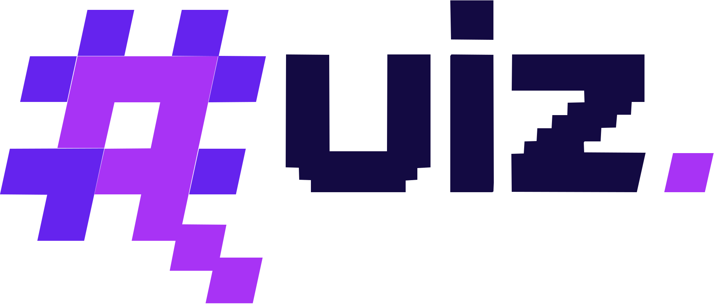

# HashQuiz

<!-- markdownlint-disable -->
<p align="center">
  <picture>
    <source media="(prefers-color-scheme: dark)" srcset="docs/brand/hashquiz-logo-dark.svg" />
    
  </picture>
</p>

<p align="center">
  
  
</p>

<p align="center">
  <strong>Kahoot-alternative — real-time multiplayer quiz platform, self-hosted on LAN</strong>
</p>

<p align="center">
  
  
  
  
  
</p>
<!-- markdownlint-restore -->

---

Host a quiz game from your laptop. Players join via QR code or join code on their phone — no account, no cloud required.

## Features

- **`.hashquiz.md` format** — write quizzes in Markdown with YAML frontmatter
- **Real-time WebSocket** — sub-second sync between host and players
- **Multi-select answers** — players toggle choices until the timer ends
- **Score by speed** — faster correct answers earn more points
- **Host dashboard** — timer ring, live answer count, bar chart reveal
- **Player mobile UI** — 2×2 answer grid, timer, feedback screen, confetti podium
- **QR code join** — scan to open the player URL pre-filled with the join code
- **LAN-first** — works fully offline, no internet required

## Tech Stack

| Layer | Technology |
|-------|-----------|
| Runtime | Bun 1.x |
| Language | TypeScript 5 (strict) |
| Frontend | Vue 3 + Vite 5 + Pinia + UnoCSS |
| Realtime | Bun native WebSocket |
| Quiz format | `.hashquiz.md` (Markdown + YAML frontmatter) |
| Monorepo | Bun workspaces |

## Installation

```bash
git clone <repo> hashquiz
cd hashquiz
bun install
```

## Usage

### Start a game

The `dev` command boots the WS server **and** both Vite frontends in one shot. Pass the path to a `.hashquiz.md` file:

```bash
# Shortest form — uses the bun script
bun run dev examples/demo.hashquiz.md

# Equivalent direct CLI call
bun run packages/server/src/cli.ts dev examples/demo.hashquiz.md

# Override the WS / HTTP port (host and player apps stay on 3031 / 3032)
bun run dev examples/quiz-ia-dev.hashquiz.md --port 4040

# Pass a decks folder: it is the decks folder for solo mode, the room deck is its first deck by id
bun run dev examples

# With a file, --decks picks the solo decks folder (default: examples/ in the monorepo, else the file's folder)
bun run dev examples/demo.hashquiz.md --decks examples
```

This starts three servers simultaneously:

| Server | URL | Role |
|--------|-----|------|
| WS / HTTP | `ws://localhost:3030` | Game logic + join codes, local solo backend (`/solo/*`) |
| Host app | `http://localhost:3031` | Desktop dashboard |
| Player app | `http://localhost:3032` | Mobile client |

Open `http://localhost:3031` on the host machine. Players scan the QR code or navigate to the printed player URL
with the join code pre-filled.

> Editing the loaded `.hashquiz.md` file prints a hot-reload notice — restart the server to apply the change.

### Validate a quiz file

Quickly check syntax and structure without starting the game:

```bash
bun run packages/server/src/cli.ts check examples/demo.hashquiz.md
```

Output: question count, theme, or a list of parsing errors with the offending question index.

### Build & test

```bash
bun test                  # Run all tests
bun run build             # Build every workspace package
bun run build:web         # Build only the host + player SPAs
bun run pack              # Stage the hashquiz npm package in pkg/
bun run build:edge        # Bundle the solo-submit Edge Function core (solo-core.js), edge scoring only
bun run lint              # Lint markdown and YAML
bun run lint:md:fix       # Auto-fix markdown
bun run commit            # Interactive gitmoji commit
```

### Solo mode locally (no Supabase)

With the local transport (the default), `hashquiz dev` also serves solo mode: the Bun server on port 3030 stores
finished runs in SQLite (`.hashquiz/solo.db` in the working directory), rescores them itself against its decks
folder, and pushes live players and new runs over the existing WebSocket. The player home lists the decks with
`solo: true` (`examples/demo.hashquiz.md` is one) and the player app reaches `http://<page hostname>:3030`.

Limits: the leaderboard exists only on the machine running `hashquiz dev` (add `.hashquiz/` to the
`.gitignore` of a decks repository), nothing is deployed online, and players must reach port 3030 of that
machine. A page served over https (a static deploy) cannot call it, so use the Supabase backend there.

### Solo mode with Supabase

Solo runs, the leaderboard and HashQuiz leads are stored in Supabase
(`packages/backend-supabase/supabase/migrations/`). Locally (Docker required):

```bash
bun run supabase:start                 # local Supabase; `supabase status --workdir packages/backend-supabase`
supabase db reset --workdir packages/backend-supabase   # apply the migrations
bun run build:edge                     # edge scoring only: bundle the Edge Function core
bun run supabase:functions             # edge scoring only; reads decks.json from HASHQUIZ_SITE_URL
```

For edge scoring, copy `packages/backend-supabase/supabase/functions/.env.example` to `.env.local` next to it:
`HASHQUIZ_SITE_URL=http://host.docker.internal:3032` points the function (in Docker) at the player dev server.

Run the apps with `VITE_TRANSPORT=supabase`, `VITE_SUPABASE_URL=http://127.0.0.1:54321` and the local anon key
(e.g. in an untracked `apps/player/.env.local` and `apps/host/.env.local`). `examples/demo.hashquiz.md` is a
`solo: true` deck: the player home lists it under the join form and its host card links to `#/solo/<deckId>`.
The dev servers serve `/hashquiz-config.js` from these files too, so the apps follow them at runtime; a shell
`VITE_TRANSPORT=local` still wins. `bun run pack` ignores them: it builds the apps with a clean env (no
`VITE_*` / `HASHQUIZ_*`, `.env*` files skipped) and refuses to stage `pkg/` if a Supabase URL or key
is baked in. `VITE_SOLO_SCORING` (or `HASHQUIZ_SOLO_SCORING` for `hashquiz build`) picks `browser` (default) or `edge`
scoring; switching to `edge` also needs `update solo_settings set scoring_mode = 'edge'`. Production steps
(`hashquiz supabase deploy` or the manual `supabase` commands) are in [`docs/DEPLOY.md`](docs/DEPLOY.md).

## Decks

Decks live in their own repositories and use the published
[`hashquiz`](docs/PACKAGE.md) npm package (CLI + prebuilt host and player apps):

- [`maxime-lenne/hashquiz-decks`](https://github.com/maxime-lenne/hashquiz-decks): Docker,
  GenAI LLM introduction, MCP intro and overview
- [`WhiteWoodTech/hashquiz-trainings-decks`](https://github.com/WhiteWoodTech/hashquiz-trainings-decks): agentic coding,
  cloud, GCP, MCP deep dive, observability

The host app of this repository lists the [`examples/`](examples/) decks (set `HASHQUIZ_DECKS_DIR`,
relative to the repo root, to list another folder). See [`docs/PACKAGE.md`](docs/PACKAGE.md) for
`hashquiz build` and the publishing steps in [`docs/DEPLOY.md`](docs/DEPLOY.md).

Example decks (smaller, for testing):

| File | Description |
|------|-------------|
| [`examples/demo.hashquiz.md`](examples/demo.hashquiz.md) | Minimal demo — start here |
| [`examples/quiz-ia-dev.hashquiz.md`](examples/quiz-ia-dev.hashquiz.md) | Larger sample on AI / dev topics |

### Authoring a new deck

Use the bundled Claude skills to scaffold a deck from scratch:

```text
/hashquiz:new           # Scaffold folder + frontmatter + assets/ + sources/
/hashquiz:plan          # Plan content from sources and generate plan.md
/hashquiz:create        # Generate questions in index.hashquiz.md from plan.md
```

Or write one by hand following the format below.

## Quiz File Format

```markdown
---
title: My Quiz
theme: dark
---

## Question text here

- [x] Correct answer
- [ ] Wrong answer A
- [ ] Wrong answer B
- [ ] Wrong answer C

> Optional explanation shown after reveal

---timer: 20
```

> **Each question must have exactly 4 choices** — the player UI is a 2×2 grid. Keep at least one
> distractor (so ≤3 correct answers per question). For multi-select, phrase as "select 2" or
> "select 3", never "select 4". **All 4 choices must look visually identical** (same markdown
> formatting, length and grammar) so the correct answer doesn't give itself away. See
> [`docs/TECHNICAL_GUIDE.md`](docs/TECHNICAL_GUIDE.md) and the `building-hashquiz-decks` skill.

## Project Structure

```text
hashquiz/
├── packages/
│   ├── parser/           # @hashquiz/parser — .hashquiz.md → Quiz object
│   ├── core/             # @hashquiz/core — GameEngine, events, types
│   ├── backend-local/    # @hashquiz/backend-local — Bun WS transport, local solo backend (SQLite)
│   ├── backend-supabase/ # @hashquiz/backend-supabase — Supabase transport, solo API, Supabase project
│   ├── server/           # @hashquiz/server — Bun HTTP+WS server + CLI
│   ├── theme-default/    # @hashquiz/theme-default — CSS design tokens
│   └── ui/               # @hashquiz/ui — shared Vue 3 components
├── apps/
│   ├── host/             # Vue 3 SPA — port 3031
│   └── player/           # Vue 3 SPA — port 3032
└── examples/
    └── demo.hashquiz.md
```

See [`docs/PROJECT_STRUCTURE.md`](docs/PROJECT_STRUCTURE.md) for the full file map.

## Documentation

| File | Description |
|------|-------------|
| [`docs/AGENTS.md`](docs/AGENTS.md) | AI assistant guide and conventions |
| [`docs/TECHNICAL_GUIDE.md`](docs/TECHNICAL_GUIDE.md) | Architecture, WS protocol, scoring |
| [`docs/PROJECT_STRUCTURE.md`](docs/PROJECT_STRUCTURE.md) | Directory and file organization |
| [`docs/SCREEN_FLOW.md`](docs/SCREEN_FLOW.md) | Host and player screen flows |
| [`docs/COMPONENT_REFERENCE.md`](docs/COMPONENT_REFERENCE.md) | `@hashquiz/ui` component API |
| [`docs/DESIGN_SYSTEM.md`](docs/DESIGN_SYSTEM.md) | CSS tokens and design decisions |
| [`docs/FEATURES.md`](docs/FEATURES.md) | Feature list and roadmap |
| [`docs/TASKS.md`](docs/TASKS.md) | Task backlog |
| [`docs/LICENSING.md`](docs/LICENSING.md) | Licensing model and FAQ |

## License

HashQuiz is **fair-code open-core**:

- **Format & tooling** (`@hashquiz/parser`, Claude skills, MCP) — MIT
- **Product** (engine, server, apps) — HashQuiz Sustainable Use License: free to self-host, including for paid
  trainings you deliver; reselling HashQuiz as a hosted service is not allowed
- **Pro / Enterprise** (`packages/ee/`) — HashQuiz Enterprise License, license key required in production

See [LICENSE.md](LICENSE.md) and the plain-language FAQ in [`docs/LICENSING.md`](docs/LICENSING.md).
Versions up to v2.0.0 remain under MIT.

## Author

**Maxime Lenne** — [maxime-lenne.fr](https://maxime-lenne.fr)
